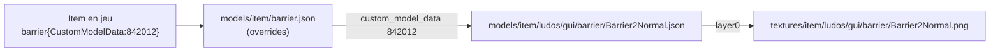
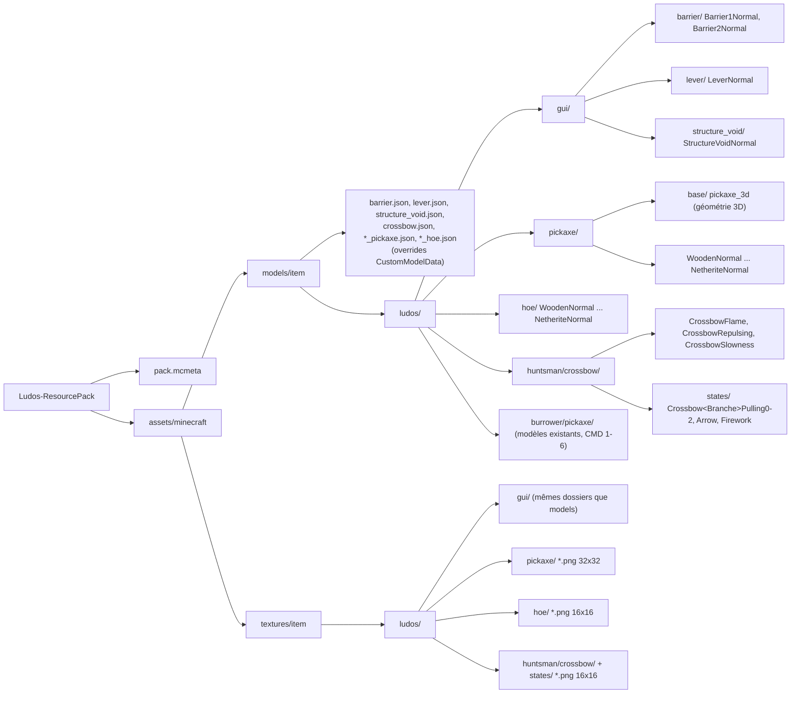

# Ludos ResourcePack
Tuto comment structurer le ressource pack de Ludos, si problème ou question étant vous êtes libre, de crée des issues dans le repo ; @feur25 répondra dès qu'il pourra

Ainsi prennez le temps de lire, et de faire abstraction de l'ortographe ; Chaque item custom réutilise un item vanilla et change d'apparence selon son **CustomModelData** (CMD).
Toutes les textures déjà présentes sont des **placeholders** : il suffit de les remplacer par le vrai dessin, sans toucher aux fichiers JSON - respecter la nomonclature est assez importante.

## Ajouter / remplacer une texture

1. Trouver l'item dans le [tableau](#tableau-des-textures) ci-dessous - qui est un simple sommaire des différentes texture disponible dans ce template ! A titre informatif cette branche git restera comme tel, lors de vos future commit, crée une branch à part sur la quel vous partagerez vos avancées. Sous peine de conséquences. PS : oui, c'est une menace.
2. Ouvrir le `.png` indiqué dans la colonne **Texture**, le redessiner en gardant **la même taille** et **le même nom**.
3. Recharger en jeu avec `F3 + T` si vous avez synchro le ressource pack - ping @feur25 quand pas la flemme pour faire une pipeline d'auto publishing quand vous faites une modifications pour voir le ressource pack maj sur vos serveur locaux pour toute l'équipe.
4. Tester avec `/give @p <item>{CustomModelData:<id>}`, par ex. `/give @p barrier{CustomModelData:842012}`.

> Les placeholders ont des petits points blancs : 1 point = variante 1, 2 points = variante 2, etc.
> Pour l'arbalète, le nombre de points indique l'état (1 = repos, 2-4 = tension, 5 = flèche chargée, 6 = feu d'artifice).

## Pioches 3D

Toutes les pioches partagent **une seule géométrie** :
`assets/minecraft/models/item/ludos/pickaxe/base/pickaxe_3d.json`

- Pour changer **la forme** : ouvrir ce fichier dans Blockbench (*Java Block/Item*), modifier, exporter au même endroit. Toutes les pioches suivent.
- Pour changer **la couleur / le dessin** d'une pioche : modifier uniquement son `.png` (32x32).

Patron UV des textures de pioche (32x32, 1 px = 1 unité) :

| Zone (px)              | Partie            |
|------------------------|-------------------|
| `x 0-32, y 0-4`        | barre de la tête  |
| `x 0-8,  y 4-20`       | manche            |
| `x 8-24, y 4-11`       | collier (jonction)|
| `x 24-32, y 4-8`       | pointe gauche     |
| `x 24-32, y 8-12`      | pointe droite     |

Chaque bloc est déplié ainsi : ligne du haut = dessus / dessous, ligne du bas = est / nord / ouest / sud.

## Fonctionnement

Règle : **le modèle et sa texture ont le même chemin** (`models/item/ludos/...json` ↔ `textures/item/ludos/...png`).

## Arborescence

## Tableau des textures

Tous les chemins partent de `assets/minecraft/`.

| Item | CMD | Texture | Format |
|---|---|---|---|
| structure_void | 842001 | `textures/item/ludos/gui/structure_void/StructureVoidNormal.png` | 2D 16x16 |
| barrier | 842011 | `textures/item/ludos/gui/barrier/Barrier1Normal.png` | 2D 16x16 |
| barrier | 842012 | `textures/item/ludos/gui/barrier/Barrier2Normal.png` | 2D 16x16 |
| lever | 842021 | `textures/item/ludos/gui/lever/LeverNormal.png` | 2D 16x16 |
| wooden_pickaxe | 842031 | `textures/item/ludos/pickaxe/WoodenNormal.png` | 3D 32x32 |
| stone_pickaxe | 842031 | `textures/item/ludos/pickaxe/StoneNormal.png` | 3D 32x32 |
| iron_pickaxe | 842031 | `textures/item/ludos/pickaxe/IronNormal.png` | 3D 32x32 |
| golden_pickaxe | 842031 | `textures/item/ludos/pickaxe/GoldenNormal.png` | 3D 32x32 |
| diamond_pickaxe | 842031 | `textures/item/ludos/pickaxe/DiamondNormal.png` | 3D 32x32 |
| netherite_pickaxe | 842031 | `textures/item/ludos/pickaxe/NetheriteNormal.png` | 3D 32x32 |
| wooden_hoe | 842041 | `textures/item/ludos/hoe/WoodenNormal.png` | 2D 16x16 |
| stone_hoe | 842041 | `textures/item/ludos/hoe/StoneNormal.png` | 2D 16x16 |
| iron_hoe | 842041 | `textures/item/ludos/hoe/IronNormal.png` | 2D 16x16 |
| golden_hoe | 842041 | `textures/item/ludos/hoe/GoldenNormal.png` | 2D 16x16 |
| diamond_hoe | 842041 | `textures/item/ludos/hoe/DiamondNormal.png` | 2D 16x16 |
| netherite_hoe | 842041 | `textures/item/ludos/hoe/NetheriteNormal.png` | 2D 16x16 |
| crossbow (Flame) | 842051 | `textures/item/ludos/huntsman/crossbow/CrossbowFlame.png` + `states/CrossbowFlame{Pulling0,Pulling1,Pulling2,Arrow,Firework}.png` | 2D 16x16 ×6 |
| crossbow (Repulsing) | 842052 | `textures/item/ludos/huntsman/crossbow/CrossbowRepulsing.png` + `states/CrossbowRepulsing{Pulling0,Pulling1,Pulling2,Arrow,Firework}.png` | 2D 16x16 ×6 |
| crossbow (Slowness) | 842053 | `textures/item/ludos/huntsman/crossbow/CrossbowSlowness.png` + `states/CrossbowSlowness{Pulling0,Pulling1,Pulling2,Arrow,Firework}.png` | 2D 16x16 ×6 |
| *_pickaxe (Burrower) | 1 – 6 | `models/item/ludos/burrower/pickaxe/*` (existant) | 3D |

## Ajouter un nouvel item

1. Créer le modèle `models/item/ludos/<groupe>/<Variante><N><Mode>.json` et sa texture au même chemin sous `textures/`.
2. Dans `models/item/<item_vanilla>.json`, ajouter un override `{"predicate": {"custom_model_data": <id>}, "model": "item/ludos/..."}`.
3. Garder les overrides **triés par CMD croissant** : Minecraft prend le dernier override dont la valeur est ≤ au CMD de l'item.
4. Les IDs Ludos commencent à `842001` (dizaine par item : 8420**1**x, 8420**2**x, ...). Le nom `<Variante><N><Mode>.json` est celui que lit `ResourcePackLoader` côté plugin.
